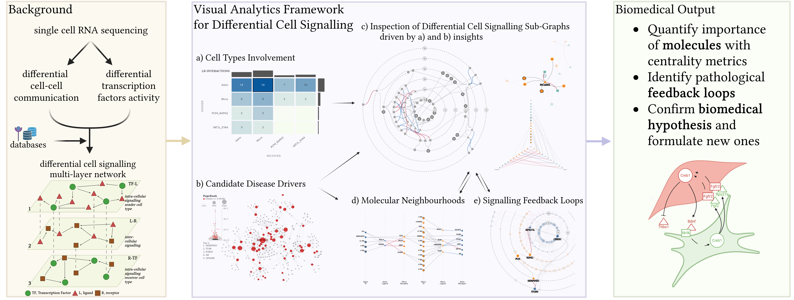

# Differential Signaling Visual Analytics Dashboard

> **Research use only. Not a medical device.** See [DISCLAIMER.md](DISCLAIMER.md) for intended use, data provenance and limitations.
> This software was developed in the HEREDITARY project as a research prototype. It has not been assessed or certified under the EU Medical Device Regulation (EU) 2017/745. It must not be used to diagnose, treat, monitor or make any other decision about individual patients.

Interactive visual analytics framework for the exploration of differential cell-cell communication (CCC) and transcription factor (TF) activity inferred from single-cell RNA sequencing (scRNA-seq) data.

The dashboard integrates intercellular communication, intracellular signaling cascades, TF regulation, and functional enrichment analysis into a unified multi-layer network representation supporting the identification of candidate disease drivers, altered signaling loops, and dysregulated regulatory programs.

[Live application](https://hereditary.cgv.tugraz.at/differential-cell-signaling/)

## Graphical Abstract

---

## Features

- Multi-layer signaling network visualization
- Coordinated interactive views
- Differential CCC exploration
- TF activity integration
- Signaling loop identification
- Functional enrichment analysis
<!-- - User-provided dataset support -->

---

## Case Studies

The dashboard currently includes:

- Amyotrophic Lateral Sclerosis (ALS)
  - familial ALS vs pathologically normal (C9ALS_vs_PN)
  - sporadic ALS vs pathologically normal (SALS_vs_PN)
  - sporadic ALS vs familial ALS (SALS_vs_C9ALS)
- Fibromuscular Dysplasia (FMD) Ko mouse model vs wildtype (Ko_vs_Wt)

---

## Technology Stack

- Frontend: Svelte + D3.js
- Backend: Python + FastAPI
- Database: PostgreSQL

## Acknowledgement

Funded by the European Union under grant agreement No 101137074 (HEREDITARY). Views and opinions expressed are however those of the author(s) only and do not necessarily reflect those of the European Union or the European Health and Digital Executive Agency (HaDEA). Neither the European Union nor the granting authority can be held responsible for them.
